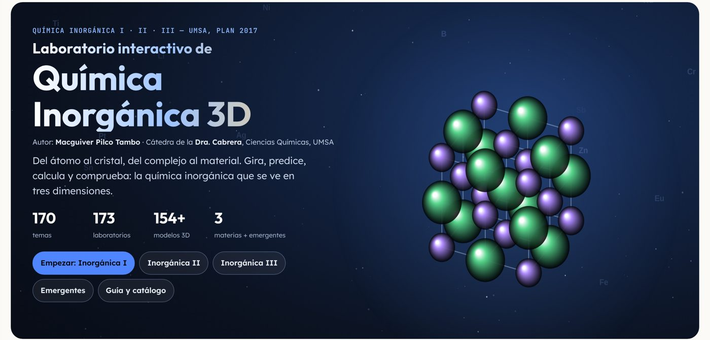
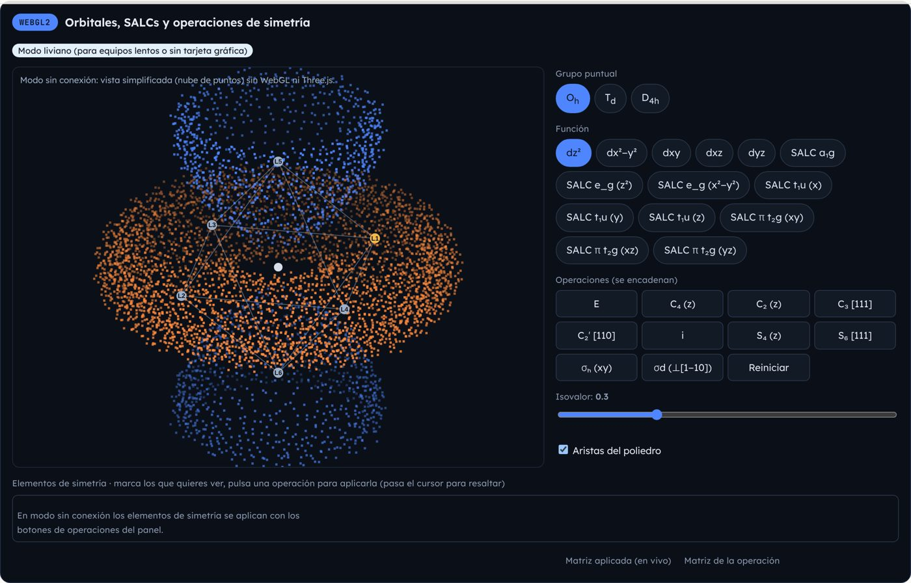
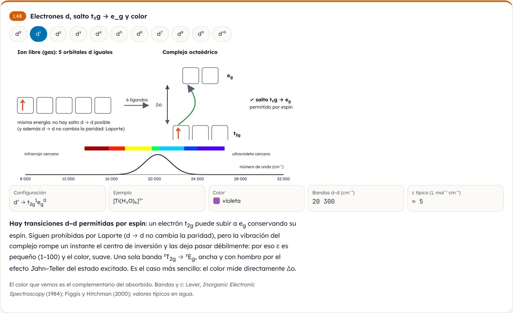
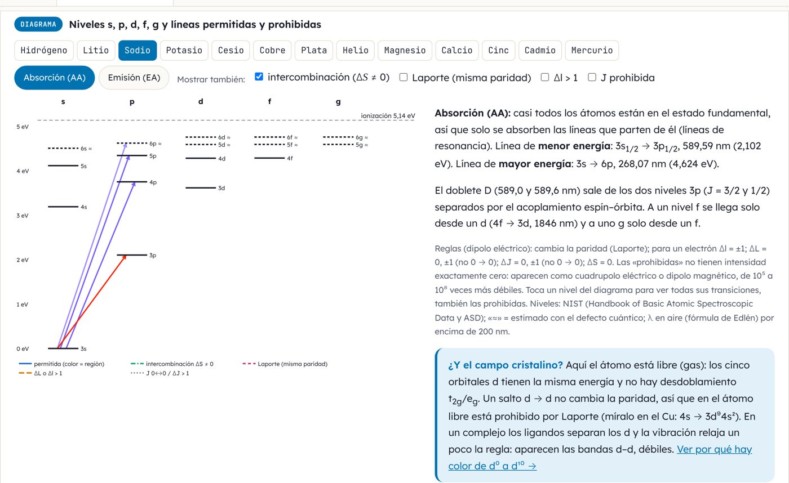
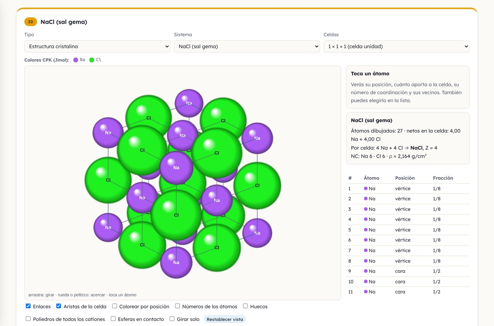

# Laboratorio Interactivo de Química Inorgánica 3D

**Del átomo al cristal, del complejo al material. Gira, predice, calcula y comprueba: la química inorgánica que se ve en tres dimensiones.**



Aplicación educativa en **un solo archivo HTML**. Funciona **sin internet**, en la computadora y en el celular, sin instalación y sin cuentas. Cubre Química Inorgánica I, II y III, el laboratorio QCI 224, las técnicas instrumentales y los temas emergentes, siguiendo el plan de estudios de la Carrera de Ciencias Químicas de la Universidad Mayor de San Andrés (La Paz, Bolivia).

| 170 temas | 173 laboratorios | 154+ modelos 3D | 0 conexiones necesarias |
|:-:|:-:|:-:|:-:|

## Usarla

- **En línea:** abre la página de GitHub Pages de este repositorio (ver «Publicar» más abajo).
- **Sin conexión:** descarga [`index.html`](index.html) y ábrelo con doble clic en Chrome, Edge, Firefox o Safari.
- **Manual:** [docs/Manual_de_uso.pdf](docs/Manual_de_uso.pdf) (12 páginas).

## Qué incluye

- **Inorgánica I:** átomo y espectros, diagrama de Grotrian de s a g con transiciones permitidas y prohibidas, términos y microestados, Lewis, VSEPR y polaridad, orbitales 3D, ácido–base, Born–Haber, Latimer, Frost y Pourbaix, cristalografía y DRX.
- **Inorgánica II:** teoría del campo cristalino completa (EECC, serie espectroquímica, color de d⁰ a d¹⁰, Tanabe–Sugano calculado, Orgel, magnetismo, EPR, Jahn–Teller y excepciones), coordinación y organometálica.
- **Inorgánica III:** bandas, Ellingham y metalurgia de minerales bolivianos, lantánidos, perovskitas, baterías, zeolitas, MOF y ruta atrano.
- **Técnicas instrumentales:** DRX, FRX, AA, ICP, UV-Vis, IR y Raman, RMN y EPR, masas, gamma y Mössbauer, XPS y UPS, SEM y TEM.
- **Herramientas:** visor 3D de cristales, 28 exámenes pasados con problemas resueltos y simulacro, prácticas de laboratorio, glosario y símbolos.

| | |
|:-:|:-:|
|  |  |
|  |  |

## Cómo enseña

- **Tres niveles de la química** (triplete de Johnstone): lo que se ve, lo que pasa en el átomo y cómo se escribe.
- **Predice antes de simular**, con diagnóstico del error de concepto de cada opción incorrecta.
- **Piso bajo, techo alto:** notas para principiantes y derivaciones para avanzados, en desplegables.
- **Modo estudio:** registra el primer intento y el grado de seguridad de cada respuesta. Ofrece mapa de dominio, repaso espaciado y un reporte (PDF y .json) para el docente.
- **Panel docente:** reúne los reportes del curso, ordena los errores de concepto más frecuentes, permite calificar con rúbrica, exporta a CSV y crea tareas con preguntas propias.
- **Privacidad:** todo se procesa en el navegador; ningún dato se envía a servidores.

## Datos y fuentes

Energías atómicas del NIST; espectros de complejos de Lever (1984) y Figgis–Hitchman (2000); radios iónicos de Shannon (1976); CRC Handbook; Housecroft–Sharpe, Shriver–Atkins, Greenwood–Earnshaw; nomenclatura IUPAC. Cada sección cita sus fuentes y distingue el valor experimental (en negrita) del valor de modelo (con «≈»).

## Código fuente

La carpeta [`src/`](src) contiene las piezas con las que se arma `index.html`:

```
cd src
python3 build.py      # genera src/index.html
cp index.html ../index.html
```

## Cómo citar

Pilco Tambo, M. (2026). *Laboratorio Interactivo de Química Inorgánica 3D* (versión 2026.11.21) [Software educativo]. https://github.com/maccpilco7/laboratorio-quimica-inorganica-3d

(Ver también [`CITATION.cff`](CITATION.cff).)

## Créditos

© 2026 **Macguiver Pilco Tambo**: concepción, dirección y contenidos. Programación y diseño con la asistencia de Claude (Anthropic).

Recurso educativo independiente, elaborado a partir del plan de estudios de la Carrera de Ciencias Químicas de la UMSA y de la bibliografía citada en cada sección. Con gratitud al Dr. Justo Zapata, cuyo material de clase de Química Inorgánica I fue un punto de partida. Los temas de la ruta atrano siguen el laboratorio virtual ATRA·LAB, en homenaje a la obra de Saúl Orlando Cabrera Medina y colaboradores (UMSA). No es una publicación oficial de la Universidad ni de sus docentes.

Tipografías Lexend, Outfit y JetBrains Mono (SIL Open Font License 1.1), incrustadas en el archivo.

## Aportar

¿Encontraste un error o tienes una mejora? Abre un *issue* en este repositorio, o usa el botón ✎ junto a cada título dentro de la aplicación.

## Licencia

[CC BY-NC-SA 4.0](LICENSE.md): puedes usarla, compartirla y adaptarla sin fines comerciales, citando al autor y compartiendo las adaptaciones con la misma licencia.
